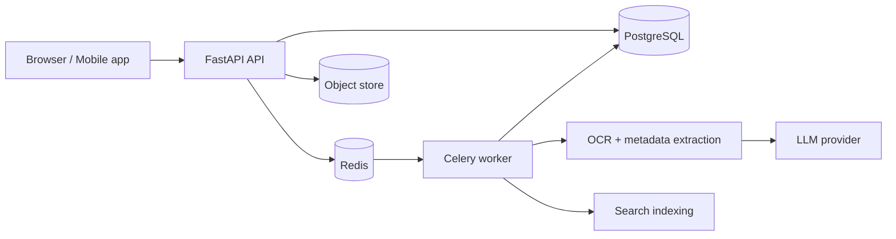

# DocuPilot

**AI-powered document management and intelligence platform.**

DocuPilot is a self-hosted app for OCR, automatic metadata extraction, document organization and grounded Q&A across your documents.


## Features

- **Upload and organize** PDFs and scanned documents
- **OCR** with an LLM or local Tesseract
- **Automatic metadata extraction** — titles, dates, tags and categories
- **Ask My Docs** — grounded Q&A with answers cited from your own documents
- **Full-text search** powered by PostgreSQL, with per-document index status and batch reindexing
- **Bring your own model** — OpenAI, Gemini or any OpenAI-compatible endpoint (LM Studio, llama.cpp, etc.)
- **Mobile app support** through a Paperless-compatible API
- **Multi-user** accounts with session auth and optional signup lock

## Tech Stack

| Layer | Tools |
|---|---|
| Backend | Python, FastAPI, SQLAlchemy, Pydantic |
| Background jobs | Celery, Redis |
| Storage | PostgreSQL, local object store |
| AI | OpenAI, Google Gemini, OpenAI-compatible APIs |
| PDF | pypdf, PDF.js viewer |
| Tooling | uv, Ruff, pytest, Docker Compose |

## Architecture



## Quick Start (Docker)

```bash
git clone https://github.com/abhisheksen777/DocuPilot.git
cd DocuPilot
export DOCUPILOT_AUTH_SECRET=your-strong-secret
make docker-up
```

Open http://localhost:8080.

To run the published image instead of building locally, use `make docker-deploy-up` (uses `docker-compose.deploy.yml`).

## Run From Source

```bash
make setup
make dev-up
```

Open http://localhost:8000. This starts the API, Celery worker, Redis and PostgreSQL. Local data lives under `local/`.

```bash
make dev-status   # check services
make dev-stop     # stop everything
make test         # run tests
```

## First-Run Setup

1. Create your account.
2. Open **Settings → Model Config**.
3. Add an **OpenAI**, **Gemini** or **Custom (OpenAI-compatible)** connection.
4. Assign models for **Metadata Extraction**, **Grounded Q&A** and **OCR**.
5. Upload a few documents and try **Ask My Docs**.

> Running a local model server on the Docker host? Use `http://host.docker.internal:<port>/v1` instead of `localhost`.

## Configuration

| Variable | Purpose |
|---|---|
| `DOCUPILOT_AUTH_SECRET` | Session signing secret — **change this** |
| `DOCUPILOT_POSTGRES_URL` | PostgreSQL connection string |
| `DOCUPILOT_REDIS_URL` | Redis connection string |
| `DOCUPILOT_OBJECT_STORE_ROOT` | Where uploaded files are stored |
| `DOCUPILOT_SESSION_COOKIE_SECURE` | `true` behind HTTPS, `false` over plain HTTP |
| `DOCUPILOT_DISABLE_SIGNUP` | `true` to block new registrations |
| `DOCUPILOT_WORKER_CONCURRENCY` | Limit worker parallelism (e.g. `1` for local models) |
| `DOCUPILOT_LLM_REQUEST_TIMEOUT_SECONDS` | Timeout for slow model backends |

## Project Structure

```
src/docupilot/
├── domain/          # Core entities
├── application/     # Use cases and services
├── adapters/        # LLM, OCR and storage adapters
├── infrastructure/  # Database and config
├── server/          # FastAPI app, templates, static UI
└── workers/         # Celery tasks
```

## Backups

Back up both volumes — the PostgreSQL data (users, records, search index) and the DocuPilot data volume (uploaded files). Restoring only one leaves the app incomplete.

## Troubleshooting

- **Logged in but bounced back to sign-in** — set `DOCUPILOT_SESSION_COOKIE_SECURE` to match your protocol (HTTP → `false`, HTTPS → `true`) on both `api` and `worker`.
- **Uploads stuck in `processing`** — make sure the worker is running and Redis is healthy: `docker compose logs -f api worker`.
- **High CPU while processing** — switch OCR away from Local Tesseract or set `DOCUPILOT_WORKER_CONCURRENCY=1`.

## Author

**Abhishek Sen** — [@abhisheksen777](https://github.com/abhisheksen777)

## License

See [LICENSE](LICENSE).
